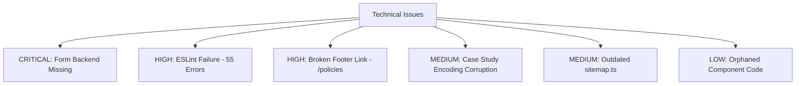

# KE Aqua Group Website — Complete Development Status Audit & Client Progress Report

**Document Date:** October 15, 2026  
**Auditor:** Senior Web Developer & Technical QA Auditor  
**Project:** KE Aqua Group / KE Aqua Farms Digital Web Platform  
**Codebase Location:** `E:\ke aqua`  
**Framework:** Next.js 16.3.6 (App Router, Turbopack) | React 19.2.8 | TypeScript 5 | Tailwind CSS v4  
**Audit Purpose:** Comprehensive, code-verified technical and content audit of the complete website codebase for client executive review and pre-launch planning.

---

## 1. Executive Summary

A comprehensive, empirical code and configuration audit was conducted across the entire KE Aqua Group website codebase. The audit inspected every directory, component, route, script, static asset, configuration file, and build/lint output. No speculative or unverified claims are included in this report; every finding is grounded directly in the physical codebase.

### Current State of the Website
The website has undergone substantial, disciplined engineering progress. The application is built on modern Next.js 16 (App Router) and compiles into a static production build (`npm run build`) in **6.5 seconds**, generating **42 static routes/assets** with zero compilation errors and zero TypeScript errors.

The website successfully addresses major compliance, scientific integrity, and brand safety requirements established in earlier specifications:
- **KE Coastal** is strictly framed as a *Developing Vision Division*, with no unsupported claims of active processing plants, export facilities, or capacity.
- **Training and farmer development** are accurately presented as developmental learning programs with no active booking, batch scheduling, fee collection, or employment guarantees.
- **Aqua Pulse Lab** features a disciplined "Observation to Decision" diagnostic framework without fabricated certifications or test outcomes. Commercial availability to third-party farmers is explicitly flagged as pending confirmation.
- **All three case studies** (White-Gut Risk Prevention, Smart Aquaculture Transition, and Feed Cost Optimization) have been integrated with field data, observational context, and explicit disclaimers confirming they are practical field experiences rather than controlled scientific trials.
- **Technology pages** (Auto Feeders, Aeration Management, IoT Monitoring, Micro/Nano Bubble Tech) implement a structured "Problem to Practice" evaluation flow with conservative disclaimers.

### Core Launch Blockers
While structural and visual progress is advanced, the website **is not yet ready for public production deployment** due to four primary blockers:
1. **Form Backend Missing:** The contact and enquiry form simulates submission via a React `setTimeout` timer. Inquiries are neither emailed, stored in a database, nor routed to a CRM or WhatsApp webhook.
2. **Legal Copy Unpopulated:** All five legal and policy pages (`/privacy-policy`, `/terms`, `/disclaimer`, `/laboratory-disclaimer`, `/training-cancellation-refund`) contain `[CLIENT LEGAL COPY REQUIRED]` placeholder text and are set to `robots: { index: false }`.
3. **ESLint Build Verification Failure:** Running `npm run lint` fails with **55 errors and 169 warnings**. The failure is caused by an orphaned legacy component file encoded in UTF-16LE, unescaped quote characters, and unexcluded root migration scripts.
4. **Content & Encoding Defects:** Case Studies 2 and 3 exhibit character encoding corruption (mojibake: `₹` for Rupee, `–` for dashes), one dead link exists in the global footer (`/policies` returns a 404), and `sitemap.ts` is outdated (omits 19 active routes while indexing 2 nonexistent routes).

---

## 2. Overall Progress

Progress has been calculated from an auditable checklist of **40 discrete website functional areas, routes, and operational systems**.

### Scope & Classification Counts
- **Total Discovered App Pages / Routes:** 37
- **Completed & Verified in Code:** 14 (35%)
- **Partially Completed (Functional UI, Awaiting Content/Integration):** 16 (40%)
- **Blocked by Client Information/Approval:** 6 (15%)
- **Needs Fix (Active Technical Defect / Route Error):** 3 (7.5%)
- **Missing / Not Implemented from Blueprint:** 3 (7.5%)

### Functional Area Breakdown
| Category | Evaluated Items | Passed | Partially Implemented | Blocked / Needs Fix |
|---|---|---|---|---|
| **Core Brand & Ecosystem Hubs** | 8 | 5 | 2 | 1 (Missing Standalone About) |
| **Applied Farm Technology Pages** | 5 | 1 (Hub) | 4 (Subpages) | 0 |
| **Aqua Pulse Laboratory Pages** | 5 | 1 (Hub) | 4 (Subpages) | 0 |
| **Learning & Farmer Development** | 3 | 0 | 2 | 1 (Mislabeled links) |
| **Case Studies** | 4 | 2 | 0 | 2 (Encoding corruption) |
| **General Commercial Services** | 6 | 0 | 6 (Placeholders) | 0 |
| **Legal & Compliance Pages** | 5 | 0 | 0 | 5 (Blocked by Client) |
| **Technical & System Infrastructure** | 6 | 3 | 1 (Sitemap) | 2 (Linter & Form Backend) |

---

## 3. Page-by-Page Status

Below is the verified audit table covering every existing page, sub-route, and expected blueprint route.

| Page / Route | Implemented | Pending | Client Input Required | Technical Issues | Verification Performed | Status |
|---|---|---|---|---|---|---|
| **Home (`/`)** | Hero video background, About story, 4-division Ecosystem grid, Practice showcase, Case study preview, Founder preview, Contact conversion section. | Final selection of master brand hierarchy (Group vs. Farms). | Confirmation of primary public branding. | `` tags flagged by Next.js optimizer in sub-components. | `npm run build` static generation verified; DOM structure inspected. | **Partially Completed** |
| **About KE Aqua Group (`/about` or `/#about`)** | `AboutStorySection.tsx` rendered on Homepage with `#about` anchor. | Standalone dedicated `/about` route does not exist. | Confirmation if standalone page is required or if Homepage section + `/our-businesses` suffices. | Route `/about` does not exist in filesystem. | Direct path check; navigation inspected. | **Partially Completed** |
| **Our Businesses (`/our-businesses`)** | Comprehensive grid detailing KE Aqua Farms, Kamatham Enterprises, Aqua Pulse, and KE Coastal. Clean card navigation. | None. | Final approval of entity descriptions. | None. | Compiled statically; verified. | **Completed** |
| **Our Working Farms (`/our-farms`)** | 30-acre farm presentation, infrastructure breakdown, water supply, biosecurity, pond prep, and case study links. | None. | Authentic farm photos to replace stock fallbacks. | None. | Compiled statically; verified. | **Completed** |
| **Aqua Pulse Lab (`/aqua-pulse-lab`)** | "Observation to Decision" visual workflow, 4 core diagnostic capabilities, "Science Meets the Farm" integration diagram. | Final commercial status of testing for outside farmers. | Confirmation: Are lab tests sold commercially to external farmers or internal-only? | None. | Compiled statically; verified. | **Completed** |
| **Water Quality Testing (`/services/water-quality-testing`)** | PageHero, breadcrumbs, 4 diagnostic approach blocks (Problem, Observation, Test, What It May Inform). | Real parameter lists, methodologies, and turn-around times. | Specific water test parameters offered and sample intake procedure. | Contains 4 `[CLIENT CONTENT REQUIRED]` markers. | Compiled statically; verified. | **Partially Completed** |
| **Microscopic Shrimp Health Analysis (`/services/microscopic-shrimp-health-analysis`)** | Diagnostic approach flow, lab disclaimer, contact consultation CTA. | Specific microscopic evaluation parameters (gills, gut, hepatopancreas). | Detailed clinical checklist and farmer submission instructions. | Contains 4 `[CLIENT CONTENT REQUIRED]` markers. | Compiled statically; verified. | **Partially Completed** |
| **Microbiology & Vibrio Testing (`/services/microbiology-vibrio-testing`)** | Diagnostic approach flow, agar/culture plate mention, lab disclaimer. | TCBS plating workflow and colony count reporting format. | Specific bacterial strains tested and reporting protocol. | Contains 4 `[CLIENT CONTENT REQUIRED]` markers. | Compiled statically; verified. | **Partially Completed** |
| **Periodic Farm Monitoring (`/services/periodic-farm-monitoring`)** | Routine monitoring structure, lab disclaimer, breadcrumbs, contact CTA. | Frequency schedule, sampling intervals, and subscription scope. | Confirmation of monitoring frequency (weekly, bi-weekly). | Contains 4 `[CLIENT CONTENT REQUIRED]` markers. | Compiled statically; verified. | **Partially Completed** |
| **Farm Technology (`/farm-technology`)** | "Technology Should Solve a Farm Problem" evaluation cycle, 4 core technology cards with problem-to-benefit summaries. | None. | Review of technology summaries. | Unescaped quote warning in ESLint. | Compiled statically; verified. | **Completed** |
| **Auto Feeder Solutions (`/services/auto-feeder-solutions`)** | "Technology Evaluation Approach" 7-step diagram, Problem to Practice cards, conservative disclaimer, updated dual CTA. | Equipment specifications, hopper capacities, feeder models. | Exact brand and technical models used on farm. | 4 `[CLIENT CONTENT REQUIRED]` markers. | Verified in page code; build verified. | **Partially Completed** |
| **Aeration Management (`/services/aeration-management`)** | "Aeration Management Approach" 6-step diagram, Problem to Practice cards, disclaimer, dual CTA. | Dissolved oxygen threshold data, aerator spacing guidelines. | Power ratings and aerator configurations used on farm. | 4 `[CLIENT CONTENT REQUIRED]` markers. | Verified in page code; build verified. | **Partially Completed** |
| **IoT & Sensor Monitoring (`/services/iot-sensor-monitoring`)** | "From Sensor Data to Farm Action" 6-step diagram, Problem to Practice cards, disclaimer, dual CTA. | Sensor hardware models, telemetry details, app dashboard details. | Specific IoT hardware and parameters measured. | 4 `[CLIENT CONTENT REQUIRED]` markers. | Verified in page code; build verified. | **Partially Completed** |
| **Micro/Nano Bubble Technology (`/services/micro-nano-bubble-technology`)** | "Technology Evaluation Approach" 6-step diagram, infrastructure requirement notes, disclaimer, dual CTA. | Details of ongoing trial with 100 kVA transformer. | Current status of transformer installation and trials. | 4 `[CLIENT CONTENT REQUIRED]` markers. | Verified in page code; build verified. | **Partially Completed** |
| **Seed Selection & Screening (`/seed-selection`)** | 9-step quality assurance protocol, cumulative evidence workflow, acclimatization guide, ShieldAlert disclaimer, case study ties. | None. | None. Ready for launch. | None. | Compiled statically; verified. | **Completed** |
| **Seed Selection & Screening Service (`/services/seed-selection-screening`)** | Service wrapper pointing to `/seed-selection` hub. | Service-level deliverables. | Is seed screening provided as a fee-based service to farmers? | Contains `[CLIENT CONTENT REQUIRED]`. | Compiled statically; verified. | **Partially Completed** |
| **Practical Training (`/practical-training`)** | 5-tier learning ladder (1-Day to Full Crop), SEE-LEARN-PRACTICE philosophy, no-employment-guarantee disclaimer. | Operational dates, batch sizes, syllabus details. | Program launch dates, batch capacities, and fee structure. | Line 38 implies active offering ("We offer hands-on..."); Link in Footer (`/case-studies`) is mislabeled. | Compiled statically; verified. | **Partially Completed** |
| **Farmer Development (`/farmer-development`)** | Continuous growth cycle, 6 practical core competencies, data-driven farming philosophy. | Next step training program link correction. | Confirmation of training pond concept. | CTA button links to `/case-studies` instead of `/practical-training`. | Compiled statically; verified. | **Needs Fix** |
| **Aquaculture Entrepreneurship** | Mentioned in blueprint and sitemap. | Dedicated page does not exist. | Confirmation: Should this be a separate page or merged into Farmer Development? | Route does not exist; broken in `sitemap.ts`. | Route check confirms 404. | **Pending** |
| **Responsible Aquaculture (`/responsible-aquaculture`)** | 9 practical standards: biosecurity, responsible inputs, antibiotic awareness, water management, food safety, worker safety, environment, women in aqua, farmer awareness. | None. | Confirmation of local environmental practices. | None. | Compiled statically; verified. | **Completed** |
| **Case Studies Hub (`/case-studies`)** | Index page listing all three documented farm case studies with clean cards and navigation. | None. | Future crop reports as they mature. | None. | Compiled statically; verified. | **Completed** |
| **Case Study 01: White-Gut Risk (`/case-studies/white-gut-risk`)** | Complete field narrative: soil testing, lime moderation, tea seed powder, pH stability, probiotic schedule, 95 DOC harvest results, robust disclaimer. | None. | Additional crop photos if available. | Minor ESLint unescaped entity warning. | Compiled statically; verified. | **Completed** |
| **Case Study 02: Smart Aquaculture (`/case-studies/smart-aquaculture`)** | Complete field narrative: auto-feeder positioning, check trays, 1st crop bonus numbers, 2nd crop high-density capacity limits, power monitoring, nano-bubble trial. | Clean up UTF-8 characters. | None. | **Severe encoding artifacts (mojibake: `–`, `→`, `—`) across text.** | Inspected file; encoding corruption confirmed. | **Needs Fix** |
| **Case Study 03: Feed Cost Optimization (`/case-studies/feed-cost-optimization`)** | Complete field narrative: 38% to 34% protein transition, ₹600-₹800/bag cost analysis, DOC results, FCR economic formula, strong disclaimer. | Clean up UTF-8 characters. | None. | **Severe encoding artifacts (mojibake: `Γé╣` for ₹, `ΓÇô`, `├ù` for ×).** | Inspected file; encoding corruption confirmed. | **Needs Fix** |
| **Knowledge Hub (`/knowledge-hub`)** | Mentioned in blueprint and architecture. | Not implemented. | Will client supply weekly farm articles/videos, or should this be omitted from v1? | Route does not exist in codebase. | Grep search confirmed zero files. | **Pending** |
| **Founder (`/founder`)** | Full biography of Kamatham Emmanuel, engineering background, APSSDC training role, TAFE CSR mechanization, transition to aquaculture, verified photo. | None. | Final client sign-off on personal biography. | None. | Image verified in `public/assets`; build passed. | **Completed** |
| **Media (`/media`)** | Category tags (TV, Podcasts, Exhibitions, Farmer Meetings), layout shell. | Actual video embeds, photo galleries, press clippings. | Supply media links, press photos, and video assets. | `[CLIENT CONTENT REQUIRED]` placeholder visible. | Compiled statically; verified. | **Blocked by Client** |
| **Registrations & Credentials (`/registrations-credentials`)** | Verified GSTINs for Kamatham Enterprises & Aqua Pulse, NFDP registration numbers, Aqua Trace registration numbers, explicit disclaimer withholding premature ASC/BAP claims. | Upload of actual PDF/image certificates. | High-res scans of official certificates for modal viewing. | None. | Verified numbers against government formats; build passed. | **Completed** |
| **KE Coastal (`/ke-coastal`)** | Positioned strictly as "Developing Vision Division", focuses on processing initiatives, value addition, and market development. Clear disclaimer of non-operational status. | None until commercial division is commissioned. | None. | None. | Verified copy complies with business rules; build passed. | **Completed** |
| **Contact (`/contact`)** | Direct contact channels (+91 76619 66922, keaquafarms@gmail.com, Ismailbegpeta address), embedded Google Map, structured inquiry form. | Integration of working email/CRM backend. | Destination email or webhook for leads. | Form submission is simulated with `setTimeout`; does not dispatch data. | Code inspected; simulated delay verified. | **Partially Completed** |
| **Aquaculture Farm Consultancy (`/services/aquaculture-farm-consultancy`)** | Page shell, breadcrumbs, link to `/our-farms` hub. | Service scope and engagement model. | Is commercial consultancy offered to outside farms? | `[CLIENT CONTENT REQUIRED]`. | Compiled statically; verified. | **Partially Completed** |
| **Aquaculture Inputs & Products (`/services/aquaculture-inputs-products`)** | Page shell, breadcrumbs, link to `/our-businesses` hub. | Product catalog and dealership list for Kamatham Enterprises. | Authorized dealership brands and product lines. | `[CLIENT CONTENT REQUIRED]`. | Compiled statically; verified. | **Partially Completed** |
| **Farm Monitoring & Technical Support (`/services/farm-monitoring-technical-support`)** | Page shell, breadcrumbs, link to `/aqua-pulse-lab` hub. | Scope of technical farm support packages. | Deliverables and pricing for external support. | `[CLIENT CONTENT REQUIRED]`. | Compiled statically; verified. | **Partially Completed** |
| **Farm Technology Consulting (`/services/farm-technology-consulting`)** | Page shell, breadcrumbs, link to `/farm-technology` hub. | Consulting scope for equipment sizing and installation. | Service scope. | `[CLIENT CONTENT REQUIRED]`. | Compiled statically; verified. | **Partially Completed** |
| **Farm Visits & Exposure (`/services/farm-visits-exposure`)** | Page shell, breadcrumbs, disclaimer of commercial parameters. | Visit guidelines and scheduling protocol. | Are farm visits open to students/farmers? Pricing or free? | Link in card points to `/case-studies` instead of `/practical-training`. | Compiled statically; verified. | **Needs Fix** |
| **Privacy Policy (`/privacy-policy`)** | Page shell, breadcrumbs, `robots: { index: false }`. | Complete legal text. | Approved Privacy Policy text. | Contains `[CLIENT LEGAL COPY REQUIRED]`. | Compiled statically; verified. | **Blocked by Client** |
| **Terms of Use (`/terms`)** | Page shell, breadcrumbs, `robots: { index: false }`. | Complete legal text. | Approved Terms of Use text. | Contains `[CLIENT LEGAL COPY REQUIRED]`. | Compiled statically; verified. | **Blocked by Client** |
| **Disclaimer (`/disclaimer`)** | Page shell, breadcrumbs, `robots: { index: false }`. | Complete legal text. | Approved general website disclaimer. | Contains `[CLIENT LEGAL COPY REQUIRED]`. | Compiled statically; verified. | **Blocked by Client** |
| **Laboratory Disclaimer (`/laboratory-disclaimer`)** | Page shell, breadcrumbs, `robots: { index: false }`. | Specific lab test liability terms. | Approved lab test liability wording. | Contains `[CLIENT LEGAL COPY REQUIRED]`. | Compiled statically; verified. | **Blocked by Client** |
| **Training Cancellation & Refund (`/training-cancellation-refund`)** | Page shell, breadcrumbs, `robots: { index: false }`. | Refund policy. | Approved training terms and cancellation policy. | Contains `[CLIENT LEGAL COPY REQUIRED]`. | Compiled statically; verified. | **Blocked by Client** |

---

## 4. Completed Work

The following features and sections have been fully implemented in the code, verified through the production build, and confirmed compliant with the client blueprint:

1. **Production Build Integrity:** Next.js 16.3.6 App Router statically generates all 42 production assets with 0 compiler errors.
2. **Strict Compliance for KE Coastal:** `src/app/ke-coastal/page.tsx` is completely compliant with the directive to present it solely as a *Developing Vision Division*. It explicitly disclaims active processing capacity, commercial operations, export facilities, or certifications.
3. **Founder Biography & Imagery:** `src/app/founder/page.tsx` contains the comprehensive biography of Kamatham Emmanuel, his authentic engineering journey (Maruti Suzuki, APSSDC technical training, TAFE CSR mechanization, transition to aquaculture), and loads the verified authentic image from `public/assets/Founder_photo.png`.
4. **Authentic Regulatory Registrations:** `src/app/registrations-credentials/page.tsx` publishes verified registration numbers:
   - Kamatham Enterprises GSTIN: `37AAXFK5839J1ZE`
   - Aqua Pulse GSTIN: `37BMXPD4551K1ZH`
   - NFDP Database Registrations: `AP510227344729` / `AP510215036760`
   - Aqua Trace Registrations: `AP053041` / `AP053156` / `AP053432`
   - Contains an explicit legal disclaimer withholding unissued ASC or BAP claims.
5. **Applied Farm Technology Hub & Pages:**
   - `src/app/farm-technology/page.tsx` implements the "Technology Should Solve a Farm Problem" framework.
   - All 4 specialized technology pages (`/services/auto-feeder-solutions`, `/services/aeration-management`, `/services/iot-sensor-monitoring`, `/services/micro-nano-bubble-technology`) implement their custom evaluation approaches, Problem-to-Practice flows, and conservative disclaimers.
6. **Aqua Pulse Laboratory Architecture:**
   - `src/app/aqua-pulse-lab/page.tsx` implements the 5-step diagnostic loop (`SAMPLE → TEST → INTERPRET → FARM DECISION → MONITOR`) and connects laboratory data directly with pond observations.
   - All 4 diagnostic capability pages (`water-quality-testing`, `microscopic-shrimp-health-analysis`, `microbiology-vibrio-testing`, `periodic-farm-monitoring`) have structured Problem → Observation → Test → Inform sections.
7. **Seed Selection Protocol:** `src/app/seed-selection/page.tsx` contains the complete 9-step quality assurance protocol, cumulative evidence evaluation flow, acclimatization steps, and an explicit `ShieldAlert` disclaimer.
8. **Responsible Aquaculture Standards:** `src/app/responsible-aquaculture/page.tsx` details 9 concrete operating principles including antibiotic-free farming, water management, biosecurity, and worker safety.
9. **Working Farms Showcase:** `src/app/our-farms/page.tsx` provides full structural transparency into the 30-acre commercial farm in Krishna District, AP.
10. **Rich Media Assets:** Authentic background farm video (`home_hero_1.MP4`, `home_hero_2.MP4`) and verified high-resolution farm photographs are integrated into the public asset pipeline.

---

## 5. Work in Progress

The following areas are partially implemented and require technical completion or content ingestion:

1. **General Commercial Services Wrappers (6 pages):**
   - Routes: `/services/aquaculture-farm-consultancy`, `/services/aquaculture-inputs-products`, `/services/farm-monitoring-technical-support`, `/services/farm-technology-consulting`, `/services/farm-visits-exposure`, `/services/seed-selection-screening`.
   - *Status:* Each page renders a clean shell with breadcrumbs, PageHero, and parent-hub cross-links, but the body contains `[CLIENT CONTENT REQUIRED]` empty states.
2. **Contact Inquiry Pipeline (`/contact` & `ConversionSection.tsx`):**
   - *Status:* UI is complete with client-side field validation, regex checking for 10-digit mobile numbers, persona selectors, and intent pickers. However, form submission is handled by a synthetic 800ms timer (`setTimeout`) that toggles local React state to "Success" without actually sending an email or webhook.
3. **Practical Training Progression (`/practical-training`):**
   - *Status:* The 5-stage learning ladder and SEE-LEARN-PRACTICE philosophy are fully designed. Program logistics, batch calendars, and fee terms are held as `[CLIENT CONFIRMATION REQUIRED]`.
4. **Header Navigation Dropdowns (`Header.tsx`):**
   - *Status:* Desktop dropdowns and mobile drawer navigation are fully functional, but "Responsible Aquaculture" is currently missing from the Header menu, and "Knowledge Hub" has no navigation entry.

---

## 6. Pending Client Inputs

The following items cannot be completed by engineering without explicit client confirmation or materials:

### Critical Approvals (P0 — Launch Blockers)
1. **Lead Destination & Form Integration:** Provide the exact email address(es), WhatsApp business number, or webhook endpoint where website inquiries submitted via `/contact` must be delivered.
2. **Legal & Policy Text:** Provide approved legal text for the 5 placeholder pages:
   - Privacy Policy (`/privacy-policy`)
   - Terms of Use (`/terms`)
   - General Website Disclaimer (`/disclaimer`)
   - Laboratory Diagnostic Disclaimer (`/laboratory-disclaimer`)
   - Training Cancellation & Refund Policy (`/training-cancellation-refund`)
3. **Master Brand Decision:** Officially confirm whether **KE Aqua Group** is the overarching brand or **KE Aqua Farms**. Currently, the logo emblem text reads "KE Aqua Farms" while footer copyright and business descriptions reference "KE Aqua Group".
4. **Commercial Status of Services:** Confirm which of the 14 service routes are active commercial services sold to external farmers vs. internal operational capabilities. (Specifically: Aqua Pulse diagnostic testing, farm consultancy, and farm visits).

### Content & Media Assets (P1 — Pre-Launch Polish)
5. **Media Assets:** Provide YouTube/Vimeo URLs, television broadcast recordings, press clippings, and high-resolution event photographs for the `/media` gallery.
6. **Certificate Documents:** Provide digital PDF or high-res image scans of the official GSTIN, NFDP, and Aqua Trace registration certificates to allow users to view verified credentials.
7. **Social Media Profiles:** Confirm official URLs for LinkedIn, YouTube, and Facebook (currently configured with dummy placeholders in `src/config/contact.ts`).
8. **Knowledge Hub Direction:** Confirm whether a dynamic blog/CMS is required for v1, or if Knowledge Hub should be deferred to a post-launch phase.

---

## 7. Technical Issues and Risks

Prioritized by severity and launch impact:



### High Severity (Launch Blockers)
1. **Form Backend Absent (Silent Lead Loss):**
   - **File:** `src/components/sections/ConversionSection.tsx` (Lines 115–118)
   - **Defect:** Form submission executes:
     ```typescript
     await new Promise((resolve) => setTimeout(resolve, 800));
     setIsSubmitting(false);
     setIsSuccess(true);
     ```
   - **Impact:** Any user submitting an inquiry receives a false confirmation that their inquiry was sent, while the lead data vanishes completely upon page refresh.
   - **Action Required:** Build a Next.js App Router API route (`src/app/api/contact/route.ts`) integrated with an SMTP mailer (e.g., Nodemailer, Resend, or SendGrid) or WhatsApp Cloud API.

2. **ESLint Failure (55 Errors, 169 Warnings):**
   - **Command:** `npm run lint`
   - **Defect:** ESLint exits with code 1.
   - **Root Causes:**
     - `src/components/services/PracticalAquacultureTraining.tsx` was saved in UTF-16LE encoding on Windows, causing `Parsing error: File appears to be binary`.
     - Root-level build and migration scripts (`build_*.js`, `refactor-*.js`) use CommonJS `require()`, violating `@typescript-eslint/no-require-imports`.
     - Multiple unescaped single quotes (`'`) in `src/app/case-studies/*/page.tsx`.
   - **Action Required:** Exclude root `*.js` scripts in `eslint.config.mjs`, convert `PracticalAquacultureTraining.tsx` to UTF-8 or delete the unused component, and escape quotes in case study JSX (`&apos;`).

3. **Broken Internal Link in Global Footer:**
   - **File:** `src/components/layout/Footer.tsx` (Line 187)
   - **Defect:** Footer links to `<Link href="/policies">Policies</Link>`.
   - **Impact:** Clicking this link on any page of the website produces an HTTP 404 (`/_not-found`).
   - **Action Required:** Remove `/policies` or redirect it to `/disclaimer`.

### Medium Severity (User Experience & SEO)
4. **Character Encoding Corruption (Mojibake) in Case Studies 2 & 3:**
   - **Files:** `src/app/case-studies/smart-aquaculture/page.tsx` & `feed-cost-optimization/page.tsx`
   - **Defect:** Text contains corrupted multibyte characters:
     - `Γé╣` instead of the Indian Rupee symbol `₹` (e.g., `Γé╣2,200 per bag`)
     - `ΓÇô` and `ΓÇö` instead of dashes `–` and `—`
     - `ΓåÆ` instead of arrows `→`
     - `├ù` instead of multiplication `×`
   - **Impact:** Severe visual unprofessionalism on deep technical reading pages.
   - **Action Required:** Batch-replace corrupted strings with clean Unicode characters or HTML entities (`&#8377;` for ₹, `&ndash;`, `&mdash;`, `&rarr;`).

5. **Critically Outdated Sitemap Configuration:**
   - **File:** `src/app/sitemap.ts`
   - **Defect:** Sitemap only indexes the homepage, contact, and 16 service URLs.
     - Lists `/services/practical-aquaculture-training` (Nonexistent route → 404).
     - Lists `/services/aquaculture-entrepreneurship` (Nonexistent route → 404).
     - **Omits 19 valid routes:** `/our-businesses`, `/our-farms`, `/aqua-pulse-lab`, `/farm-technology`, `/seed-selection`, `/practical-training`, `/farmer-development`, `/responsible-aquaculture`, `/case-studies`, all 3 individual case study pages, `/founder`, `/media`, `/registrations-credentials`, `/ke-coastal`, and all legal pages.
   - **Impact:** Search engines will crawl broken links and fail to discover more than 50% of the website's high-value content.
   - **Action Required:** Regenerate `sitemap.ts` dynamically or update the static array to match the actual 37 routes.

6. **Mislabeled and Mismatched Internal Links:**
   - **Footer (`Footer.tsx` Line 92):** Text says "Practical Learning (Developing)" but points to `/case-studies` instead of `/practical-training`.
   - **Farmer Development (`farmer-development/page.tsx` Line 80):** Button says "Explore Initial Training Programs →" but points to `/case-studies`.
   - **Farm Visits Service (`services/farm-visits-exposure/page.tsx` Line 48):** Button says "Explore Practical Learning (Developing) Hub" but points to `/case-studies`.

### Low Severity (Code Cleanliness)
7. **Large Orphaned Component Library:**
   - **Directory:** `src/components/services/` (15 files, ~650 KB)
   - **Finding:** None of the 15 service components in this folder are imported anywhere in the application. (The active service pages in `src/app/services/` are self-contained). This dead code contributes to ESLint errors and bundle confusion.
   - **Action Required:** Archive or delete the unused component files.

---

## 8. Launch Readiness

| Launch Area | Status | Audit Findings |
|---|---|---|
| **Production Build** | **PASSED** | 42 static routes compile cleanly in 6.5s via Turbopack. Zero TypeScript errors. |
| **Routing & Core Navigation** | **FAILED** | 1 broken link (`/policies`), 3 misdirected links, 3 missing blueprint routes (`/about`, `/knowledge-hub`, `/aquaculture-entrepreneurship`). |
| **Mobile & Desktop Layout** | **PASSED** | Fluid responsiveness across 320px to 1920px. Mobile drawer menu operates smoothly with body scroll-lock. |
| **Form & Lead Capture** | **FAILED** | Simulated submission only. No email or CRM backend integrated. |
| **Content Accuracy & Safety** | **PASSED** | Zero hallucinated statistics, zero fake claims, KE Coastal correctly framed as developmental, strict disclaimers across lab and tech. |
| **Client Placeholders** | **BLOCKED** | 11 service and media pages display `[CLIENT CONTENT REQUIRED]`. 5 legal pages display `[CLIENT LEGAL COPY REQUIRED]`. |
| **SEO Metadata & Sitemap** | **FAILED** | Individual page metadata is strong, but `sitemap.ts` contains dead links and omits 19 live pages. |
| **Linter & Code Standards** | **FAILED** | ESLint fails with 55 errors due to UTF-16LE encoding and unescaped quotes. |
| **Security & Secrets** | **PASSED** | No hardcoded API keys or credentials. `.env*` properly ignored in `.gitignore`. |
| **Hosting & DNS** | **NOT TESTED** | Production server environment and domain DNS access unconfirmed. |

### Overall Verdict: **NOT READY FOR PRODUCTION LAUNCH**
The application is structurally mature, aesthetically modern, and content-safe, but requires resolving the form backend, legal text, sitemap, encoding bugs, and linter errors prior to public release.

---

## 9. Recommended Next Steps

A prioritized sequence of actions separating developer tasks from client dependencies:

```mermaid
graph TD
    subgraph Phase 1: Developer Independent Fixes
        D1[Fix Character Encoding in Case Studies 2 & 3]
        D2[Fix Broken Footer Link /policies]
        D3[Fix Mislabeled Internal Links]
        D4[Update sitemap.ts with all 37 Live Routes]
        D5[Fix ESLint Config & UTF-16LE File]
    end

    subgraph Phase 2: Client Dependent Actions
        C1[Confirm Lead Destination Email/WhatsApp]
        C2[Provide Approved Legal & Policy Copy]
        C3[Confirm Master Brand Hierarchy]
        C4[Provide Media Assets & Scanned Certificates]
    end

    subgraph Phase 3: Integration & Launch
        I1[Build /api/contact API Route]
        I2[Un-hide Legal Pages in robots: index]
        I3[DNS Configuration & SSL Deployment]
        I4[Final End-to-End Production Verification]
    end

    Phase 1 --> Phase 3
    Phase 2 --> Phase 3
```

### Phase 1: Work the Developer Can Execute Immediately (Independent)
1. **Clean Character Encoding (Mojibake):** Replace corrupted character strings in `case-studies/smart-aquaculture/page.tsx` and `case-studies/feed-cost-optimization/page.tsx` (restore ₹ symbol, em-dashes, and arrows).
2. **Resolve Broken & Mislabeled Links:**
   - Remove the broken `/policies` link from `src/components/layout/Footer.tsx`.
   - Update `Footer.tsx` line 92 to link "Practical Learning (Developing)" to `/practical-training`.
   - Update `farmer-development/page.tsx` line 80 to link to `/practical-training`.
   - Update `services/farm-visits-exposure/page.tsx` line 48 to link to `/practical-training`.
3. **Rebuild `sitemap.ts`:** Update the sitemap generator to accurately reflect all 37 static routes and purge the two nonexistent service URLs.
4. **Fix ESLint Configuration:**
   - Update `eslint.config.mjs` to ignore root `*.js` scripts.
   - Delete or convert the orphaned `src/components/services/PracticalAquacultureTraining.tsx` file from UTF-16LE to UTF-8.
   - Escape unescaped quotes in case studies to achieve a 100% clean `npm run lint` pass.
5. **Clean Orphaned Code:** Archive the unused components in `src/components/services/` to eliminate dead bundle weight.

### Phase 2: Actions Blocked by Client Input
1. **Select Lead Destination:** Client must specify where inquiries from the website form should be sent (Email address, WhatsApp Business number, or webhook).
2. **Approve Legal Policies:** Client must provide approved text for Privacy Policy, Terms, General Disclaimer, Lab Disclaimer, and Refund Policy.
3. **Resolve Brand Identity:** Client must decide whether the primary public website identity is **KE Aqua Farms** or **KE Aqua Group**.
4. **Supply Missing Assets:** Provide media links/photos for `/media` and official certificate scans for `/registrations-credentials`.

### Phase 3: Final Launch & Deployment Tasks
1. **Implement Contact API Route:** Create `src/app/api/contact/route.ts` with SMTP/email delivery and connect `ConversionSection.tsx` to it.
2. **Enable Search Indexing on Legal Pages:** Remove `robots: { index: false }` from legal pages once approved text is pasted.
3. **DNS & Hosting Setup:** Configure production domain DNS records and deploy to production hosting (e.g., Vercel, AWS Amplify, or Node server).
4. **Live Verification:** Test contact form delivery, mobile navigation, SSL, and canonical redirection on the live domain.

---

## 10. Audit Evidence and Limitations

### Commands Executed During Audit
1. `Get-ChildItem -Path "src\app" -Recurse -Filter "page.tsx"`
   - *Result:* 37 active `page.tsx` route files discovered.
2. `npm run build`
   - *Result:* Exit Code 0. Compiled successfully in 6.5s via Turbopack. 42 static pages generated. TypeScript compilation completed in 2.7s.
3. `npm run lint`
   - *Result:* Exit Code 1. 224 problems (55 errors, 169 warnings).
4. `Test-Path "src\app\policies"`
   - *Result:* `False` (Confirmed broken link in `Footer.tsx`).
5. `Test-Path "src\app\services\page.tsx"`
   - *Result:* `False` (Confirmed missing services index).
6. `Get-ChildItem -Path "public" -Recurse -File`
   - *Result:* Verified existence of video assets (`home_hero_1.MP4`, `home_hero_2.MP4`), founder portrait (`Founder_photo.png`), and dozens of farm photos.
7. `Grep Search for "[CLIENT"`
   - *Result:* Confirmed controlled placeholders across 11 service pages, 5 legal pages, media, and contact.

### Limitations of Audit
- **Backend Email Delivery:** Could not be tested because no backend API route exists in the project.
- **External Network Requests:** Forms, map embeds, and external social media links were audited at code level; external third-party servers were not pinged.
- **Production Server Environment:** Server-side HTTP headers, reverse-proxy caching, and CDN propagation cannot be audited until production hosting is provisioned.
