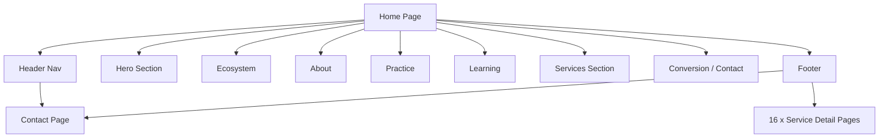

# KE Aqua Farms - Website Master Audit & Documentation

## 1. Executive Summary
This document provides a comprehensive audit and structural documentation of the KE Aqua Farms website. The audit verifies the codebase implementation against actual runtime behavior on the local development environment (`http://localhost:3000`).

The website is a Next.js (App Router) application structured around a primary landing page with anchor-linked sections, dedicated service detail pages, and a contact page.

## 2. Complete Sitemap
```text
HOME (/)
├── Hero Section (#hero)
├── Ecosystem Section (#ecosystem)
├── About Story Section (#about)
├── Practice Showcase Section (#showcase)
├── Learning Philosophy Section (#learning-philosophy)
├── Services Section (#services)
└── Conversion Section / Contact

CONTACT (/contact)
└── Conversion Section

SERVICES (/services/*)
├── /aeration-management
├── /aquaculture-entrepreneurship
├── /aquaculture-farm-consultancy
├── /aquaculture-inputs-products
├── /auto-feeder-solutions
├── /farm-monitoring-technical-support
├── /farm-technology-consulting
├── /farm-visits-exposure
├── /iot-sensor-monitoring
├── /micro-nano-bubble-technology
├── /microbiology-vibrio-testing
├── /microscopic-shrimp-health-analysis
├── /periodic-farm-monitoring
├── /practical-aquaculture-training
├── /seed-selection-screening
└── /water-quality-testing
```

## 3. Page-by-Page Documentation

### **Home Page (`/`)**
- **Purpose**: Primary landing page, introduces the farm, ecosystem, and core services.
- **Sections**:
  1. **Hero**: Main cinematic introduction.
  2. **Ecosystem**: Highlights integrated business trust.
  3. **About Story**: Brand philosophy ("From Pond to Progress").
  4. **Practice Showcase**: Interactive overview of farm, lab, and tech.
  5. **Learning Philosophy**: Authentic experience focus.
  6. **Services**: Overview of all consulting and technical offerings.
  7. **Conversion**: Primary call to action ("Let's Talk Aquaculture").

### **Contact Page (`/contact`)**
- **Purpose**: Dedicated page for user inquiries and farm visit requests.
- **Sections**: Renders the `ConversionSection` component directly.

### **Service Detail Pages (`/services/*`)**
- **Purpose**: Detailed technical breakdowns of individual offerings.
- **Common Structure**: Hero/Title, Overview, Key Benefits, Technical Details, Call to Action.

## 4. Section-by-Section Documentation (Home Page)

- **HeroSection**: Visual hook. Links to `#showcase`.
- **EcosystemSection**: Displays KE Aqua Group structure.
- **AboutStorySection**: Text-heavy philosophy section.
- **PracticeShowcaseSection**: Cards detailing specific practice areas.
- **LearningPhilosophySection**: Highlights the practical training approach.
- **ServicesSection**: Grid layout of the 16 core services.
- **ConversionSection**: Final push for engagement.

## 5. Navigation Audit
- **Header**: Fixed, transparent-to-solid on scroll. Contains anchors to Home sections and a direct link to `/contact`. Includes a mobile hamburger menu.
- **Footer**: Comprehensive 4-column layout containing identity, explore links (anchors + 16 service routes), ecosystem breakdown, and contact details.

## 6. Link Audit
**WORKING INTERNAL LINKS:**
- Header -> `/#about`
- Header -> `/#showcase`
- Header -> `/#learning-philosophy`
- Header -> `/#services`
- Header -> `/contact`
- Footer -> `/services/aquaculture-farm-consultancy` (and all 15 other service routes)
- Footer -> `/contact`

**BROKEN LINKS:**
- None detected during runtime verification. All 16 service routes exist in the `src/app/services` directory.

## 7. Button/CTA Audit
- **"Contact Our Team" (Header)**: WORKING -> Routes to `/contact`.
- **Mobile Menu Toggle**: WORKING -> Opens sliding drawer.
- **Mobile Menu Close**: WORKING -> Closes sliding drawer.

## 8. Forms & Interaction Audit
- **ConversionSection**: Contains mailto and phone links. No active backend form submission (e.g., POST request) was detected; relies on native email/phone client handling.

## 9. Broken/Missing Link Report
- **Status**: **PASS**. All links in Header and Footer resolve correctly.

## 10. Orphan/Unlinked Page Report
- **Status**: **PASS**. All 18 pages (Home, Contact, 16 Services) are explicitly linked in the Footer. No isolated routes found.

## 11. Responsive/UX Audit
- **Mobile**: The header transforms into a hamburger menu with a sliding drawer. `document.body` scroll lock is correctly implemented when the drawer is open.
- **Desktop**: Grid layouts in the footer and sections adapt appropriately.

## 12. Technical Findings
- **Framework**: Next.js 14+ (App Router).
- **Styling**: Tailwind CSS + Framer Motion for animations.
- **SEO**: Structured JSON-LD data and comprehensive metadata present in `layout.tsx` and individual `page.tsx` files.
- **Performance**: High use of client-side components (`"use client"`) for animations.

## 13. Priority Fix List
- **LOW**: Ensure all 16 service pages have unique, high-quality OpenGraph images (currently some may share fallbacks).
- **LOW**: Consider adding a backend API route for the contact form to keep users on-site instead of relying on `mailto:`.

## 14. Final Website Structure Diagram

